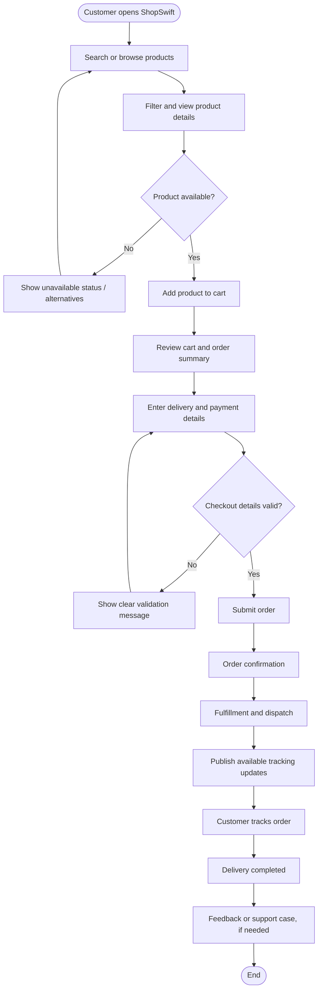

# ShopSwift – Conceptual Future-State Customer Journey

This is a conceptual future-state model for discussion. Confirm system events, exception handling, payment flows, inventory reservation, returns and delivery integrations with process owners and technical stakeholders before treating it as an approved design.
